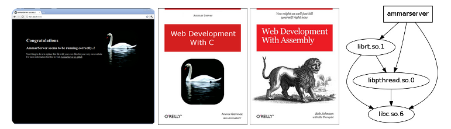

# AmmarServer
## A lightweight extendable barebones HTTP server for linux

Please see the wiki for more info on whats going on in this repository : )
https://github.com/AmmarkoV/AmmarServer/wiki

This repository is also tracked via OpenHub
https://www.openhub.net/p/AmmarServer

One of the most basic philosophies behind this is to try to add as much functionality possible in a reusable way *WITHOUT* overly increasing loc and dependencies.. The biggest recent improvements have been actually trying to merge common functionality and reducing loc. 

AmmarServer is a C library : a web service is a small C program that registers C callbacks as dynamic resources
and lets the library handle sockets , HTTP parsing , caching , compression , sessions , logging and banning of
misbehaving clients. A number of ready made [services](#services) are included.

Videos of AmmarServer in action :
-  [AmmarServer demo](https://youtu.be/vlwd5Ojf7Q0)
-  [Hobbit EU Project](https://www.youtube.com/watch?v=41_8ktacxt8)
-  [MyRemoteDesktop](https://www.youtube.com/watch?v=aqH25ocm-Tc)

## Repository layout
------------------------------------------------------------------

| Path | What it contains |
|---|---|
| [src/AmmServerlib](src/AmmServerlib) | The AmmarServer library itself ( `libAmmarServer.a` / `libAmmarServer.so` ) , configured through [server_configuration.h](src/AmmServerlib/server_configuration.h) |
| [src/AmmClient](src/AmmClient) | A small HTTP client library |
| [src/Hashmap](src/Hashmap) , [src/InputParser](src/InputParser) , [src/CSVParser](src/CSVParser) | Support libraries used by the server and the services |
| [src/UserAccounts](src/UserAccounts) | User accounts / logins ( plus the `ammarserver_adduser` and `ammarserver_passwd` tools ) |
| [src/AmmCaptcha](src/AmmCaptcha) , [src/BasicImaging](src/BasicImaging) | Captcha generation and JPEG / PNG / thumbnail handling |
| [src/ASVIO](src/ASVIO) | A Gradio like Python front end built on AmmarServer |
| [src/StringRecognizer](src/StringRecognizer) , [src/StringEscapeFile](src/StringEscapeFile) , [src/FileToString](src/FileToString) , [src/AmmMessages](src/AmmMessages) | Code generation tools |
| [src/Services](src/Services) | The web services , see [src/Services/README.md](src/Services/README.md) |
| [tests](tests) | The test suite , see [tests/README.md](tests/README.md) |
| [scripts](scripts) | Run scripts for every service , benchmarks , install / deployment helpers |
| [public_html](public_html) | Default web root of the vanilla server |

## Building
------------------------------------------------------------------ 

The projects build dependencies are the gcc compiler , pthreads , cmake and pretty basic things 
so if you issue `sudo apt-get install cmake build-essential` ( assuming a Debian/Ubuntu based system ) you should be able to compile it without problems..

Optional dependencies :
-  Compression is supported , so you might want to also `apt-get install liblzma-dev` if you [ENABLE_COMPRESSION at server_configuration.h](src/AmmServerlib/server_configuration.h)
-  MyURL and V4L2ToHTTP need libjpeg in order to [serve captchas](src/AmmCaptcha) / images , so to add it `sudo apt-get install libjpeg-dev`
-  HTTPS needs OpenSSL ( `sudo apt-get install libssl-dev` ) , MyRemoteDesktop needs X11 ( `sudo apt-get install libxt-dev` )
-  `scripts/get_dependencies.sh` installs the usual set in one go

To perform a compilation you just need to issue from the root directory

    mkdir build && cd build && cmake .. && make

This should compile the library , the support libraries and all of the services. The service binaries end up next to
their sources ( e.g. `src/Services/AmmarServer/ammarserver` ) and are started with the scripts in `scripts/`.

The build is hardened by default ( `-fstack-protector` , full RELRO , `-O2` ). Optional features are switched on
with cmake options , e.g. `cmake -DUSE_OPENSSL=ON ..` :

| Option | Default | What it does |
|---|---|---|
| `USE_OPENSSL` | OFF | HTTPS support ( required by Ammarflix ) |
| `USE_LIBEVENT` | OFF | Use libevent as a threading mechanism |
| `USE_XSERVER` | OFF | Build MyRemoteDesktop ( needs X11 ) |
| `COMPILE_FOR_ARM` | OFF | Build for ARM / Raspberry Pi ( `-march=armv8-a` ) |
| `USE_AMMMESSAGES` | OFF | Build AmmMessages for generating custom messages through http |
| `DO_TEST_COVERAGE` | OFF | Build with [gcov](https://en.wikipedia.org/wiki/Gcov) coverage and the C unit testers |

To update your version of the project you can use the provided script that updates directly from github
It will remove any changes you have made to any of the files in the repository   
`scripts/update_from_git.sh`

### Writing your own service

The best way to start is copying [src/Services/SimpleTemplate](src/Services/SimpleTemplate/main.c) , a very well
documented template , into a new directory under `src/Services/` and adding it to the top level `CMakeLists.txt`.
See [src/Services/README.md](src/Services/README.md) for how the existing services are organized.

## Running
------------------------------------------------------------------

After building the server

-  `scripts/run_ammarserver` will start a basic file server ( serving public_html/ files ) on [localhost:8080](http://localhost:8080)
-  `./startAmmarServerSuite.sh` will start most of the services simultaneously so you can try them out..
-  `./stopAmmarServerSuite.sh` will stop them

Every service has command line arguments ( e.g. `-p PORT` ) , and the vanilla server can also be configured through
`ammServ.conf` / [default.conf](default.conf).

## Services
------------------------------------------------------------------

Details , ports and requirements for each service are in **[src/Services/README.md](src/Services/README.md)**.

| Service | Description | Run script |
|---|---|---|
| [AmmarServer](src/Services/README.md#ammarserver) | The "vanilla" static file server + dynamic page demos | `scripts/run_ammarserver` |
| [SimpleTemplate](src/Services/README.md#simpletemplate) | Documented template for your own service | `scripts/run_simpleTemplate` |
| [MyURL](src/Services/README.md#myurl) | URL shortener like tinyurl , bitly , goo.gl etc.. | `scripts/run_myurl` |
| [MyLoader](src/Services/README.md#myloader) | File upload service | `scripts/run_myloader` |
| [MyBlog](src/Services/README.md#myblog) | Blog engine that can use Wordpress skins | `scripts/run_myblog` |
| [MyTube](src/Services/README.md#mytube) | Youtube like video site | `scripts/run_mytube` |
| [MySearch](src/Services/README.md#mysearch) | Google like front page ( cosmetic only ;P ) | `scripts/run_mysearch` |
| [GeoPosShare](src/Services/README.md#geoposshare) | GPS location sharing for mobile phones | `scripts/run_geoposshare` |
| [Social](src/Services/README.md#social) | Small social network / chat | `scripts/run_social` |
| [HabChan](src/Services/README.md#habchan) | 4chan like image board | `scripts/run_habchan` |
| [ShareTex](src/Services/README.md#sharetex) | Multiuser LaTeX collaboration | - |
| [Availability](src/Services/README.md#availability) | Group scheduling polls | - |
| [SuperMarket](src/Services/README.md#supermarket) | Shared shopping list | - |
| [Ammarflix](src/Services/README.md#ammarflix) | Private HTTPS-only video library | `scripts/run_ammarflix` |
| [APushService](src/Services/README.md#apushservice) | Push / alarm / monitoring endpoint for devices | `scripts/run_pushservice` |
| [AmmBus](src/Services/README.md#ammbus) | Web front end for a serial ( Arduino / ESP32 ) device | - |
| [V4L2ToHTTP](src/Services/README.md#v4l2tohttp) | Serves a V4L2 camera over HTTP | `scripts/run_v4l2tohttp` |
| [WebFramebuffer](src/Services/README.md#webframebuffer) | Framebuffer image updated over HTTP | - |
| [ImageGeneration](src/Services/README.md#imagegeneration) | Web front end for AI image generation | `scripts/run_imagegeneration` |
| [MyRemoteDesktop](src/Services/README.md#myremotedesktop) | Control your linux desktop through a browser | `scripts/run_myremotedesktop` |
| [Various](src/Services/README.md#various) / [Deprecated](src/Services/README.md#deprecated) | Robot specific utilities and discontinued services | - |

## Testing
------------------------------------------------------------------

The test suite starts the real `ammarserver` binary on a free loopback port with a temporary web root,
templates directory, log directory and configuration, then drives it with raw sockets. It covers:

- HTTP features: byte ranges/HEAD, Host enforcement, absolute-form targets, chunked bodies,
  `Expect: 100-continue`, conditional requests and `ammServ.conf` parsing.
- General behavior: MIME types, index files, directory listings, methods, keep-alive, ETag stability,
  compression negotiation, concurrency and access/error logging.
- Security/pentests: path traversal, symlink escapes, malformed and oversized requests, header floods,
  request-smuggling framing, oversized bodies and slow-client resilience.

Run everything (builds first):

    bash tests/run_tests.sh

Pass `--no-build` to skip the build step, or run one module with
`./tests/run_tests.sh tests.test_security`.

The same suite can also be run under analysis tools , each building its own unstripped binaries into `build/` :

    ./tests/run_cppcheck.sh          # cppcheck static analysis -> build/cppcheck/report.txt
    ./tests/run_valgrind.sh          # server under valgrind memcheck ( --helgrind for data races )
    ./tests/run_sanitizers.sh        # ASan + LSan + UBSan build

See `tests/README.md` for the layout, environment variables, the legacy shell pentest fixtures and the manual
load-test scripts.

## Performance
------------------------------------------------------------------

AmmarServer includes an epoll-driven fast path for serving cached static files ( simple GET/HEAD requests
with no query string, Range, ETag/compression negotiation, or auth - see [epollFastPathServer.c](https://github.com/AmmarkoV/AmmarServer/blob/master/src/AmmServerlib/threads/epollFastPathServer.c) ) that serves them
without ever spinning up a worker thread. Everything else ( dynamic pages, POST, uncached files, Range requests )
still goes through the regular thread-per-connection pipeline unchanged. Access/error logging is sharded across
`LOG_SHARD_COUNT` independent files+mutexes ( [server_configuration.h](https://github.com/AmmarkoV/AmmarServer/blob/master/src/AmmServerlib/server_configuration.h) ) rather than one global lock shared by
every request-serving thread - measured to recover most of the throughput a single shared logging mutex was
otherwise costing under concurrent load.

Benchmarked with [wrk](https://github.com/wg/wrk) ( `scripts/benchmark_vs_apache.sh` ) against a locally running
Apache 2.4 + mod_php on the same machine, keep-alive connections, byte-identical static file on both sides
( a 15.9KB PNG ):

| Concurrency | AmmarServer | Apache | AmmarServer lead |
|---|---|---|---|
| 20 connections  | 160,948 req/s | 107,355 req/s | +50% |
| 100 connections | 181,877 req/s | 117,378 req/s | +55% |
| 200 connections | 170,788 req/s | 116,086 req/s | +47% |

AmmarServer also shows noticeably lower and more consistent per-request latency throughout ( sub-millisecond at
low concurrency, under 1ms average even at c=200, vs Apache's 8-9ms average under the same load ). Take this as a
rough, single-machine snapshot rather than a rigorous lab benchmark - re-run `scripts/benchmark_vs_apache.sh` on
your own hardware and content for numbers that mean something for your deployment ( it auto-detects your Apache
docroot, stages a temporary copy of the comparison files there, and removes them again afterward - see the
script's own header comment for options ).

### Compute-bound dynamic content : C callback vs PHP

Static-file serving mostly measures I/O and connection-handling overhead. To see what AmmarServer's model - a
compiled C callback linked directly into the server, vs a script re-interpreted by PHP on every request - is
worth when a page actually has to *do* something, both sides run the same non-trivial, deterministic task : count
the primes below N=100,000 with a Sieve of Eratosthenes and sum them.

-  C : [`prepare_primes_content_callback`](https://github.com/AmmarkoV/AmmarServer/blob/master/src/Services/AmmarServer/main.c) , registered as `/primes.html` , `DIFFERENT_PAGE_FOR_EACH_CLIENT` ( a fresh computation on every request, same as the PHP side )
-  PHP : [`scripts/benchmark_primes.php`](https://github.com/AmmarkoV/AmmarServer/blob/master/scripts/benchmark_primes.php) , the same algorithm, deployed under Apache + mod_php ( `scripts/benchmark_vs_apache.sh` stages/removes it automatically )

Both sides print the prime count and sum they computed ( `primes_below_n=9592 sum_of_primes=454396537` ) so the
two implementations can be diffed for correctness - they match exactly.

| Concurrency | AmmarServer (C) | Apache + mod_php | AmmarServer lead |
|---|---|---|---|
| 20 connections  | 38,176 req/s | 2,273 req/s | ~17x |
| 100 connections | 39,384 req/s | 1,965 req/s | ~20x |
| 200 connections | 41,322 req/s | 1,913 req/s ( timeouts start appearing ) | ~22x |

Apache's prefork MPM hands each PHP request to its own process and re-interprets the script from scratch every
time ; throughput plateaus almost immediately regardless of concurrency, and latency balloons ( 8.8ms average at
c=20 up to 129ms average / 1.99s worst-case at c=200, with socket timeouts starting to appear ) as requests queue
up waiting for a free worker process. AmmarServer's compiled callback keeps scaling with concurrency and stays in
the low-single-digit-millisecond range throughout ( 0.5ms average at c=20, still only 4.9ms average at c=200 ).
Measured standalone with the CLI ( no web server in the loop ), the same algorithm already runs about 9x faster in
C than in PHP ( 0.4ms vs 3.7ms ) - the rest of the gap comes from PHP's per-request interpreter/process overhead on
top of that.

`scripts/benchmark_ammarserver.sh` and `scripts/benchmark_vs_nginx.sh` are also provided for benchmarking
AmmarServer on its own and against nginx.

## Installing
------------------------------------------------------------------

Install scripts are provided ( ./install.sh and ./uninstall.sh ) but at the moment they only provide the "vanilla" file static server. Until sufficient testing has been done it is not advisable to use this in a production enviornment.. 

`scripts/init.d` , `scripts/systemd` and `scripts/upstart` contain service definitions , and
`scripts/configureApacheAsProxy.sh` sets up Apache as a reverse proxy in front of AmmarServer services.

------------------------------------------------------------------

AmmarServer is also an integral part , providing network connectivity and used in the following projects :
-  [V4L2ToHTTP](https://github.com/AmmarkoV/V4L2ToHTTP/)
-  [RoboVision](https://github.com/AmmarkoV/RoboVision/)
-  [FlashySlideshows](https://github.com/AmmarkoV/FlashySlideshows/)
-  [RGBDAcquisition](https://github.com/AmmarkoV/RGBDAcquisition)

This project has also been successfully deployed as a means to control embedded platforms like Robots
-  For [Hobbit EU Project](https://www.youtube.com/watch?v=41_8ktacxt8) , http://hobbit.acin.tuwien.ac.at/
-  For [GuarddoG Robot](https://www.youtube.com/watch?v=61GGKFbzG7I) , https://github.com/AmmarkoV/RoboVision/blob/master/Documentation/GuarDDoG_RoboVision.pdf
-  For [Softbank NAO Robot Realtime Bridge](https://www.youtube.com/watch?v=axfKwyVTRuA)
