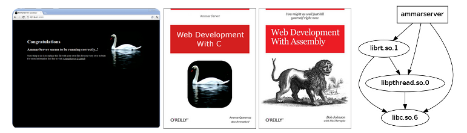

# AmmarServer Services
## The web services that ship with AmmarServer

This directory contains all the services someone can use with AmmarServer.
Every service is a small C program that links against the AmmarServer library ( `src/AmmServerlib` ), registers
a few C callbacks as dynamic resources and lets the library handle everything else ( sockets, HTTP parsing,
caching, logging, banning misbehaving clients etc ).
The libraries these projects depend upon live in the parent directory ( `src/` ) of this Services directory.

All services are built by the top level `cmake` build ( see the [main README](../../README.md#building) ) and
the binaries end up next to their sources ( e.g. `src/Services/MyURL/myurl` ).
Run scripts live in `scripts/` and are meant to be started from anywhere , they `cd` to the repository root
themselves. Most of them respawn the server if it exits. Any extra arguments are passed straight to the service
( e.g. `scripts/run_myurl -p 9000` ).

A developer should probably copy the [SimpleTemplate](#simpletemplate) directory and create his or her project
here so that things are kept tidy and neat.

## Overview
------------------------------------------------------------------

| Service | What it is | Port | Run script |
|---|---|---|---|
| [AmmarServer](#ammarserver) | The "vanilla" static file server + dynamic page demos | 8080 | `scripts/run_ammarserver` |
| [SimpleTemplate](#simpletemplate) | Documented starting point for your own service | 8080 | `scripts/run_simpleTemplate` |
| [MyURL](#myurl) | URL shortener ( tinyurl / bitly like ) with captchas | 8082 | `scripts/run_myurl` |
| [MyLoader](#myloader) | File upload service | 8085 | `scripts/run_myloader` |
| [MyBlog](#myblog) | Blog engine that can use Wordpress skins | 8086 | `scripts/run_myblog` |
| [MyTube](#mytube) | Youtube like video site | 8084 | `scripts/run_mytube` |
| [MySearch](#mysearch) | Google like front page ( cosmetic only ) | 8080 | `scripts/run_mysearch` |
| [GeoPosShare](#geoposshare) | GPS location sharing server for mobile phones | 8081 | `scripts/run_geoposshare` |
| [Social](#social) | Small social network / chat | 8087 | `scripts/run_social` |
| [HabChan](#habchan) | 4chan like image board | 8083 | `scripts/run_habchan` |
| [ShareTex](#sharetex) | Multiuser LaTeX collaboration | 8090 | - |
| [Availability](#availability) | Group scheduling polls ( whenavailable.com like ) | 8091 | - |
| [SuperMarket](#supermarket) | Shared shopping list | 8092 | - |
| [Ammarflix](#ammarflix) | Private HTTPS-only video library | 443 | `scripts/run_ammarflix` |
| [APushService](#apushservice) | Push / alarm / monitoring endpoint for devices | 8087 | `scripts/run_pushservice` |
| [AmmBus](#ammbus) | Web front end for a serial ( Arduino / ESP32 ) device | 8080 | - |
| [V4L2ToHTTP](#v4l2tohttp) | Serves a V4L2 camera as JPEG over HTTP | 8082 | `scripts/run_v4l2tohttp` |
| [WebFramebuffer](#webframebuffer) | A framebuffer image that can be updated over HTTP | 8080 | - |
| [ImageGeneration](#imagegeneration) | Web front end for AI image generation | 8080 | `scripts/run_imagegeneration` |
| [MyRemoteDesktop](#myremotedesktop) | Control your linux desktop through a browser | 8080 | `scripts/run_myremotedesktop` |
| [Various](#various) | NaoNetWalk , ScriptRunner ( robot specific utilities ) | 8080 | `scripts/run_scriptrunner` |
| [Deprecated](#deprecated) | CinemaPilot | 8080 | `scripts/run_cinemapilot` |

The port column is the port the run script uses ( or the service default when there is no script ). Note that
several services default to 8080 and that Social and APushService both use 8087 , so pass `-p` to pick another
port when running them side by side.

-  `./startAmmarServerSuite.sh` ( repository root ) will start MyURL , MyLoader , MyTube , MyBlog , GeoPosShare ,
   MySearch , APushService and ( when the games repository is checked out ) frisk simultaneously so you can try them out..
-  `./stopAmmarServerSuite.sh` will stop them , `./restartAmmarServerSuite.sh` will restart them

## Showcase services
------------------------------------------------------------------

### AmmarServer
[src/Services/AmmarServer/](AmmarServer/) - `scripts/run_ammarserver` - [localhost:8080](http://localhost:8080)

A simple (but extensible) webserver serving the `public_html/` files , plus a few dynamic pages showcasing the
API ( stats , forms , and the `/primes.html` compute benchmark used in the [performance section](../../README.md#performance) ).
This is also what `./install.sh` installs and what the test suite drives.

### SimpleTemplate
[src/Services/SimpleTemplate/](SimpleTemplate/) - `scripts/run_simpleTemplate` - [localhost:8080](http://localhost:8080)

A very well documented template for starting to build your own webserver , see
[main.c](SimpleTemplate/main.c). Copy this directory , rename it and add it to the top level `CMakeLists.txt`.

### MyURL
[src/Services/MyURL/](MyURL/) - `scripts/run_myurl` - [localhost:8082](http://localhost:8082)

A URL shortener service like tinyurl , bitly , goo.gl etc.. It uses [AmmCaptcha](../AmmCaptcha) to
serve captchas , so it needs libjpeg ( `sudo apt-get install libjpeg-dev` ).

### MyLoader
[src/Services/MyLoader/](MyLoader/) - `scripts/run_myloader` - [localhost:8085](http://localhost:8085)

A file uploader service.

### MyBlog
[src/Services/MyBlog/](MyBlog/) - `scripts/run_myblog` - [localhost:8086](http://localhost:8086)

A small Wordpress like blog engine that can use Wordpress skins..

### MyTube
[src/Services/MyTube/](MyTube/) - `scripts/run_mytube` - [localhost:8084](http://localhost:8084)

A Youtube like clone. It indexes video directories and generates thumbnails / video pages for them. You will need
to change the `VIDEO_FILES_PATH_*` paths in [main.c](MyTube/main.c) and recompile.
`convertToHTML5Video.sh` helps convert videos to a browser friendly format.

### MySearch
[src/Services/MySearch/](MySearch/) - `scripts/run_mysearch` - [localhost:8080](http://localhost:8080)

A server that serves a google like front page ( that does no searching though and is only cosmetic ;P ).

### GeoPosShare
[src/Services/GeoPosShare/](GeoPosShare/) - `scripts/run_geoposshare` - [localhost:8081](http://localhost:8081)

A GPS location server to track mobile phones ( see this [Android Application](https://github.com/AmmarkoV/GPSTransmitter) ).

## Community services
------------------------------------------------------------------

### Social
[src/Services/Social/](Social/) - `scripts/run_social` - [localhost:8087](http://localhost:8087)

A small social network with logins , posts , follows , notifications , media and chat. Every page is session
enabled , so it is also the reference for using sessions , `AmmServer_CurrentUsername()` and CSRF tokens.
Its data lives in `db/social.db` , `db/follows.db` and `db/notifications.db`.

### HabChan
[src/Services/HabChan/](HabChan/) - `scripts/run_habchan` - [localhost:8083](http://localhost:8083)

A 4chan like engine for hosting a small image board , with boards , threads , posts and moderation.

### ShareTex
[src/Services/ShareTex/](ShareTex/) - `src/Services/ShareTex/sharetex` - [localhost:8090](http://localhost:8090)

A tiny multiuser LaTeX collaboration service ( projects , a shared editor with cursors , and compilation ).
Uses the [UserAccounts](../UserAccounts) library for logins.

### Availability
[src/Services/Availability/](Availability/) - `src/Services/Availability/availability` - [localhost:8091](http://localhost:8091)

A tiny group-scheduling poll service ( modeled on whenavailable.com ).

### SuperMarket
[src/Services/SuperMarket/](SuperMarket/) - `src/Services/SuperMarket/supermarket` - [localhost:8092](http://localhost:8092)

A shared shopping-list service , a C clone of a standalone PHP tool that stays wire-compatible with its
`supermarket.py` command line front-end ( included in the directory ).

### Ammarflix
[src/Services/Ammarflix/](Ammarflix/) - `scripts/run_ammarflix` - https://localhost

A private video library. It scans media directories for video files and lets logged in users search and watch
them ( with subtitles ). Ammarflix refuses to run without HTTPS :

-  Build with `cmake -DUSE_OPENSSL=ON ..`
-  It needs a certificate ( `scripts/createSSLCert.sh` , the run script uses `key/cert.pem` and `key/key.pem` )
-  It listens on port 443 ( needs root or `sudo setcap cap_net_bind_service=+ep src/Services/Ammarflix/ammarflix` ),
   plain HTTP is only served on loopback ( port 8097 )
-  Add users first with `src/Services/Ammarflix/ammarflix -adduser NAME`
-  Extra media directories can be added with `scripts/run_ammarflix -media /extra/dir`

## Device and hardware services
------------------------------------------------------------------

### APushService
[src/Services/APushService/](APushService/) - `scripts/run_pushservice` - [localhost:8087](http://localhost:8087)

An endpoint where authenticated devices ( serial + key ) push readings and alarms , with account and monitoring
pages ( e.g. humidity plots ). Part of the AmmBus project.

### AmmBus
[src/Services/AmmBus/](AmmBus/) - `src/Services/AmmBus/ammbus [/dev/ttyUSB0]` - [localhost:8080](http://localhost:8080)

Bridges a serial device ( `/dev/ttyUSB0` , 9600 baud by default ) to a web `commander.html` page. The matching
microcontroller firmware is in the `arduino/` and `esp32/` subdirectories ( see `esp32/README` ).

### V4L2ToHTTP
[src/Services/V4L2ToHTTP/](V4L2ToHTTP/) - `scripts/run_v4l2tohttp` - [localhost:8082](http://localhost:8082)

Grabs frames from a Video4Linux2 camera ( `/dev/video0` by default ) and serves them as JPEG images , needs libjpeg.
Usage is `v4l2tohttp BIND_IP PORT DEVICE`. The standalone project lives at [V4L2ToHTTP](https://github.com/AmmarkoV/V4L2ToHTTP/).

### WebFramebuffer
[src/Services/WebFramebuffer/](WebFramebuffer/) - `src/Services/WebFramebuffer/webframebuffer` - [localhost:8080](http://localhost:8080)

Serves a framebuffer image ( `framebuffer.jpg` ) that can be updated by uploading a new frame over HTTP.

### ImageGeneration
[src/Services/ImageGeneration/](ImageGeneration/) - `scripts/run_imagegeneration` - [localhost:8080](http://localhost:8080)

A web front end for an AI image generation demo : visitors enter a query , get the generated images back and can
have them e-mailed to them. Uses the [BasicImaging](../BasicImaging) library.

### MyRemoteDesktop
[src/Services/MyRemoteDesktop/](MyRemoteDesktop/) - `scripts/run_myremotedesktop` - [localhost:8080](http://localhost:8080)

A remote desktop session viewable by a browser that allows controlling your linux desktop
( see [video](https://www.youtube.com/watch?v=aqH25ocm-Tc) ). It needs X11 ( `sudo apt-get install libxt-dev` ) and is
only built with `cmake -DUSE_XSERVER=ON ..`. It is not started by `startAmmarServerSuite.sh`.

## Various
------------------------------------------------------------------

Utilities written for specific use-cases ( [src/Services/Various/](Various/) ) :

-  **NaoNetWalk** - a web control page ( `/control.html` ) for walking a Softbank NAO robot
   ( see [video](https://www.youtube.com/watch?v=axfKwyVTRuA) )
-  **ScriptRunner** - runs predefined scripts / poses on a robot from a web page , written for the
   [Hobbit EU Project](https://www.youtube.com/watch?v=41_8ktacxt8) , has hardcoded ROS paths

## Deprecated
------------------------------------------------------------------

Projects in [src/Services/Deprecated/](Deprecated/) have been discontinued and remain in a limbo until they prove
to be useful or completely removed..

-  **CinemaPilot** - remote control for an mplayer based full screen video player

[Apolls](Apolls/) is an unfinished polls prototype that is not part of the cmake build.

## Games
------------------------------------------------------------------

`src/AmmarServerGames` ( e.g. **frisk** , `scripts/run_frisk` ) is a separate git repository. The top level build
compiles it when it is checked out and ignores it otherwise , see its own README for details.
